# 深圳 1980—2026 · 手作城市模型 × 霓虹夜景

> 一座被放回桌面上的深圳：纸、哑光树脂、微型木构件与薄层亚克力。
> 从蛇口滩涂到湾区天际线，白天与夜晚共享同一条 1980—2026 时间轴；夜晚是同一座城市从渔村灯火到 APEC 2026 的霓虹生长。

[](LICENSE)
[](package.json)
[](#技术栈)
[](#构建)

<p align="center">
  <a href="docs/screenshots/sz-2026.png"></a>
  <a href="docs/screenshots/sz-night-2.png">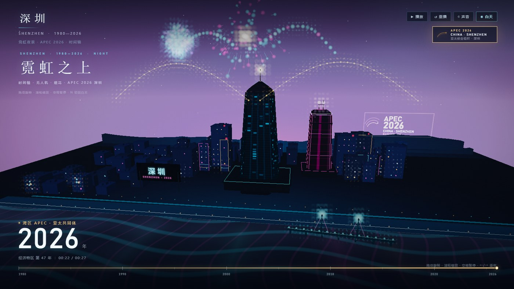</a>
</p>

<p align="center">
  <sub><b>白天</b> · 纸、树脂与木 / 1980—2026 时间轴</sub>
  &nbsp;&nbsp;·&nbsp;&nbsp;
  <sub><b>霓虹夜景</b> · 无人机编队 / 烟花 / 湾区夜色</sub>
</p>

---

## 这是什么

这是一个**可离线打开的单文件 WebGL 作品**，也是一份可以继续维护的 Three.js 工程。交付物为根目录的 **`index.html`（约 0.81 MB，零依赖）**。

- **白天**：1980 → 2026 的城市生长时间轴。蛇口滩涂、国贸、地王、福田 CBD、平安金融中心依次出现；三组日常生活切片与 20 个 1:87 人物同时在场。
- **夜晚**：独立的霓虹夜景场景，同样从 1980 生长到 2026。霓虹窗格、亮起的滨海步道、亚克力水面反射、48 架无人机编队和 APEC 烟花。
- **两个版本都突出 APEC 2026 深圳主办标识**：常驻 HUD 徽标；白天有西侧水岸 APEC 牌，夜间有悬浮霓虹牌与金色“鹏翼”光带。
- **同一页面切换**：右上角「夜景 / 白天」按钮，或按 `N`；两个场景共享同一个年份、播放和拖动进度。
- **零运行时依赖**：Three.js r160 已内联，所有纹理、招牌、蒸汽、水面、无人机和烟花均为程序化生成。没有 CDN、外部图片、字体或音频文件。

这并非测绘模型或真实航拍：地标距离、城市进深、山体高度与人物尺度都经过有意识的艺术压缩。

---

## 双场景

### 白天 · 手作城市模型

- 平安金融中心位于福田中部偏南，作为画面主中心；轮廓、塔冠、塔尖与幕墙体积清楚。
- 地王大厦在罗湖方向形成右后层次；深圳湾海岸、红树林、绿道与斜拉桥横贯南部前景。
- 建筑为哑光树脂、细卡纸与微型木构件；屋顶、路面、草皮、树林与水面先组成连续大形。
- 单一左前上方约 45° 柔和主光 + 低强度环境补光/反弹，所有投影与亮面由同一照明关系解释。
- 以地标和三处生活场景为锚点的移轴模糊；外围轻微虚化，主体保持清楚。
- 不使用霓虹窗光、Bloom、星点、满画面碎亮点或塑料高光掩盖结构。

**时间轴（两个版本共用）**：默认停在 2026，点「播放 / 重播」从 1980 开始，约 **27.7 秒**走完，在 8 个关键年份停顿；拖动底部时间轴可跳到任意年份。白天和夜晚共享同一个 `elapsed / year / playing`，切换场景不会重置进度。

### 霓虹夜景 · 1980—2026

- 独立 `nightScene`、独立相机、独立灯光与 Bloom 后期；不覆盖白天场景的材质和光源。
- 夜间城市不是一张固定海报：城市体量按年份从地面生长；1980 保留渔村、渔船、旧招牌和零星灯火；1996 地王、2016 平安依次点亮；2026 进入 APEC 终章。
- 霓虹幕墙、楼体轮廓灯、屋顶霓虹字、点亮的滨海步道与湾区水面反射。
- **48 架无人机**：两翼 + 机身的编队，轻微呼吸/振翅，带短拖尾。
- **烟花**：760 粒子池、多轮爆发、重力/阻力、拖尾线段与中心闪光。
- 夜景保留完整年份面板、播放/暂停、重播、底部时间轴与拖动；不再隐藏时间轴。早期夜空会自动向西侧渔村平移，2026 回到湾区主天际线。
- 切回白天时保留当前年份、播放状态和用户视角。

### APEC 2026 · 深圳主办标识

- **HUD 徽标**：右上角常驻「APEC 2026 / CHINA · SHENZHEN / 亚太经合组织 · 深圳」，到达 2026 时进入金色高亮状态。
- **白天**：西侧水岸的 APEC 牌与金色翼线，在 2025 后出现，作为手作模型里的主办城市迎宾装置。
- **夜晚**：悬浮的 APEC 2026 霓虹牌 + 横跨天际线的金色“鹏翼”光带；无人机与烟花在 2025 后进入。
- 标识为项目原创的主办城市视觉（非官方会徽），使用 APEC 2026、CHINA · SHENZHEN 与深圳中文署名，不复制任何受保护的官方图形。

---

## 快速开始

### 直接打开

双击根目录的 [`index.html`](index.html)。页面不依赖任何外部文件，`file://` 可直接运行。

### 本地服务（推荐）

需要 **Node.js 22+**。项目零依赖，**不需要 `npm install`**。

```bash
# 克隆后进入目录
npm run serve
# → http://127.0.0.1:8123/index.html
```

也可以使用任意静态服务器：

```bash
python -m http.server 8123
```

### 构建

`index.html` 是生成物，由 `src/` 与 `vendor/` 拼接：

```bash
npm run build       # 重新生成 index.html
npm run check       # 语法检查 + 构建
```

> 不要直接编辑 `index.html`。请改 `src/shell.html`、`src/style.css`、`src/app.js`，
> 然后提交源码和重新生成的 `index.html`；CI 会校验两者一致。

---

## 操作

| 操作 | 效果 |
| --- | --- |
| 拖动画面 | 旋转查看 |
| 滚轮 | 推近 / 拉远 |
| 双击画面 | 复位视角 |
| `空格` / 右上「播放」 | 播放 / 暂停（白天与夜景共用） |
| `←` `→` | 逐年前后跳转（白天与夜景共用） |
| `R` / 右上「重播」 | 从 1980 重新播放（白天与夜景共用） |
| 底部时间轴 | 点击或拖动跳转到任意年份（两个版本共用） |
| 右上「夜景 / 白天」或 `N` | 切换霓虹夜景 / 白天模型，保留当前年份与播放状态 |
| 夜景中 `Esc` | 返回白天 |
| 右上「声音」 | 开启程序化环境声（海浪 → 工地 → 城市脉冲 → 终章钟鸣） |

右上角 APEC 2026 徽标在两个版本中始终可见；年份越过 2024.55 后进入金色高亮。

触屏设备支持拖动与双指缩放；小屏会压缩品牌副标题、章节与时间轴留白，年份与可拖动时间轴仍然保留。

---

## 时间轴锚点

| 年份 | 场景 |
| --- | --- |
| 1980 | 蛇口滩涂、渔村、稻田、木栈桥、渔船、标语牌「时间就是金钱，效率就是生命」 |
| 1985 | 国贸大厦拔起，罗湖初代天际线 |
| 1990 | 建设年代：塔吊、脚手架 |
| 1996 | 地王大厦，深圳第一次触摸天空 |
| 2004 | 福田 CBD、市民中心大屋顶 |
| 2011 | 京基 100，天际线第二次跃升 |
| 2016 | 平安金融中心 · 599 米 |
| 2026 | 湾区天际线、深圳湾大桥、三处日常生活切片 |

1999 / 2018 / 2021 / 2024 等年份在镜头行进中经过，并出现在年代标签里。截图总览按 12 个年份取样。

---

## 三组生活切片

同一座城市，不做拼贴窗口；三组人物分布在相邻但不同的真实小区域里。

| 区域 | 人数 | 动作 |
| --- | ---: | --- |
| ① 福田/罗湖老街巷 · 早餐肠粉摊 | 5 | 摊主递肠粉、上班族接餐、顾客扫码、排队看菜单、端豆浆 |
| ② 深圳湾绿道 | 6 | 骑行者停车喝水、跑步、牵狗、拍照、扶栏杆看海、扫地 |
| ③ 城中村巷口 · 菜市场 | 9 | 摊主理荔枝、称重、顾客提菜、递鞋、修鞋匠、挑菜、推小车、老人看报、小孩拉购物袋 |

共 **20 个不重复的 1:87 人物**：

- 脚接地、手与物件接触、身体有受力姿态；
- 无真人面孔、无大头卡通、无展示队列；
- 每个人物由程序化几何合并为单网格，颜色、衣着、姿态与随身物件单独配置；
- 早餐摊有蒸炉白汽、折叠桌、菜单与扫码牌；绿道有栏杆、共享单车、狗与牵引绳；菜市场有荔枝/蔬菜摊、秤、修鞋摊、卷闸门与窄巷台阶。

---

## 技术栈

| 层 | 实现 |
| --- | --- |
| 渲染 | Three.js r160（内联，MIT），WebGL |
| 构型 | 程序化几何 + `InstancedMesh` 城市 + 合并式人物/道具 |
| 材质 | 程序化 `CanvasTexture`：纸纤维、木纹、草皮、幕墙、招牌、霓虹窗格 |
| 水面 | 自定义 `ShaderMaterial`（Fresnel、细波纹、克制高光） |
| 后期（白天） | HalfFloat RT → ACES、暖灰分级、锚点移轴模糊、抖动 |
| 后期（夜晚） | 亮部提取 → 单级分离高斯模糊 → ACES + Bloom 合成 |
| 动画 | 自写分段缓动时间轴、生长矩阵、无人机/烟花粒子池 |
| 声音 | WebAudio 程序化生成，无音频文件 |
| 构建 | Node.js 原生 ESM 脚本，无打包器、无 npm 依赖 |

### 性能（headless Chromium / SwiftShader，1600×900）

| 视图 | Draw calls | Triangles |
| --- | ---: | ---: |
| 白天 2026 | ≈145 | ≈56k |
| 霓虹夜景 2026 | ≈30 | ≈11.2k |

通过合并几何、实例化、`Points` 与半分辨率 Bloom 控制开销。夜景将城市窗光、步道灯、桥灯、塔顶光点、APEC 鹏翼灯点合并为一个静态 `Points`，将建筑轮廓、店招、塔身霓虹线、桥缆和 APEC 翼线合并为一个 `LineSegments`；城市换成 5 个可生长的实例化网格，地标 clone 按材质合并。2026 夜景约 30 draw calls / 11.2k 三角面。真实 GPU 上会明显更快。

更多内部细节见 [docs/ARCHITECTURE.md](docs/ARCHITECTURE.md)。

---

## 项目结构

```text
.
├── index.html                  # 生成并提交的单文件交付物（GitHub Pages 部署对象）
├── package.json                # 零依赖；build / serve / shoot / smoke 脚本
├── README.md
├── LICENSE                     # 项目 MIT
├── CONTRIBUTING.md
├── CHANGELOG.md
├── .editorconfig
├── .gitattributes
├── .gitignore
├── .nvmrc                      # Node 22
│
├── src/
│   ├── app.js                  # 全部三维场景、人物、时间轴、昼夜后期
│   ├── shell.html              # 页面骨架、HUD、夜景图注
│   └── style.css               # HUD、时间轴、夜景模式样式
│
├── vendor/
│   ├── three.min.js            # Three.js r160（内联源，MIT）
│   ├── LICENSE.three
│   └── README.md
│
├── scripts/
│   ├── build.mjs               # 校验源码 → 生成 index.html
│   ├── serve.mjs               # 零依赖静态服务器
│   ├── shoot.mjs               # 无头 Chromium 截图（时间轴 / 特写 / 夜景）
│   ├── smoke.mjs               # 播放、切换、响应式冒烟测试
│   └── browser.mjs             # 跨平台浏览器探测
│
├── docs/
│   ├── ARCHITECTURE.md         # 坐标、场景、管线、性能、扩展指南
│   ├── hero-day.jpg
│   ├── hero-night.jpg
│   ├── contact-sheet.jpg
│   ├── thumbs/                 # README 用轻量缩略图
│   └── screenshots/            # 全部验收截图与 12 年总览（PNG）
│
└── .github/workflows/
    ├── verify.yml              # 构建校验 + index.html 一致性
    └── pages.yml               # GitHub Pages 自动构建与发布
```

---

## 开发

### 环境

- Node.js **22+**（截图脚本使用全局 `fetch` 与 `WebSocket`）
- 任意现代浏览器；无 npm 依赖
- 可选：Chrome / Edge / Chromium，用于 `npm run shoot` 与 `npm run smoke`

```bash
git clone https://github.com/Zerlinw/shenzhen-1980-2026-3d.git
cd shenzhen-1980-2026-3d
npm run serve
```

### 脚本

| 命令 | 作用 |
| --- | --- |
| `npm run build` | 重新生成 `index.html` |
| `npm run serve` / `npm run preview` | 本地静态服务器，默认 `127.0.0.1:8123` |
| `npm run check` | `node --check src/app.js` + 构建 |
| `npm run shoot` | 截取 2026 白天主视图 |
| `npm run shoot -- --years=1980,1996,2026` | 截取指定年份 |
| `npm run shoot -- --years=2026 --close --night` | 白天主视图 + 场景特写 + 霓虹夜景 |
| `npm run shoot:all` | 生成 12 年 + 特写 + 夜景的单张验收图（总览图为已提交的合成图） |
| `npm run smoke` | 播放/暂停、昼夜切换、响应式测试 |

截图默认写入 `docs/screenshots/`，可通过 `--out=DIR` 修改。浏览器自动探测失败时：

```bash
CHROME=/absolute/path/to/chrome npm run shoot -- --years=2026 --night
```

`shoot.mjs` 的完整选项：

```text
--years=LIST    逗号分隔年份（默认 2026）
--out=DIR       输出目录（默认 docs/screenshots）
--url=URL       页面地址（默认 file:// 的 index.html）
--size=WxH      视口（默认 1600x900）
--port=N        CDP 端口（默认 9333）
--close         额外截取 2026 场景特写
--night         额外截取霓虹夜景
```

### 调试 API

浏览器控制台可访问 `window.__sz`：

```js
__sz.setYear(1996)        // 跳年并暂停
__sz.play(); __sz.pause()
__sz.setMode('night')     // 进入霓虹夜景
__sz.setMode('day')       // 返回白天
__sz.info()               // mode / year / draw calls / triangles
__sz.debug.nightAt(5.6)   // 设置夜景环境动画时间，便于截图
__sz.debug.look(9,17,20, 0,14,-4)
__sz.debug.resetLook()
```

---

## 部署到 GitHub Pages

仓库已包含 `.github/workflows/pages.yml`：推送 `main` 后自动构建单文件并发布。

1. 打开仓库 **Settings → Pages**。
2. 在 **Build and deployment → Source** 选择 **GitHub Actions**。
3. 推送到 `main`（或手动运行 **Deploy GitHub Pages** workflow）。
4. 部署地址通常为：

   ```text
   https://<your-username>.github.io/<repo-name>/
   ```

   本仓库 remote 为 `Zerlinw/shenzhen-1980-2026-3d`，对应：

   ```text
   https://zerlinw.github.io/shenzhen-1980-2026-3d/
   ```

> 页面本身是单文件，部署时只上传 `index.html`；`docs/` 与 `src/` 不需要发布。
> 若默认分支不是 `main`，请同步修改 `pages.yml` 的 `branches`。

也可以部署到任意静态托管（Netlify、Vercel、Cloudflare Pages、对象存储），只需上传 `index.html`。

---

## 验收

已在本机无头 Chromium（Edge/Chrome + SwiftShader）验证：

- `file://` 直接打开、场景 `ready`、控制台无报错；
- 首屏 2026 白天暂停、播放/暂停/重播、声音、逐年跳转、时间轴拖动；
- 夜景时间轴：播放时 `elapsed` 递增；2026 夜景显示年份面板、时间轴、播放/重播与章节；APEC 徽标进入 `live` 金色状态；
- 昼夜切换、`N` 快捷键、`body.night` HUD、切换后保留年份与播放状态；
- 900×600 白天与 2026 夜景响应式；
- 白天 ≈145 draw calls / ≈56k 三角面；夜景 2026 ≈30 / ≈11.2k；2016 ≈19 / ≈10.8k。

重新验收：

```bash
npm run check
npm run smoke
npm run shoot:all
```

---

## 截图

### 十二个年份

[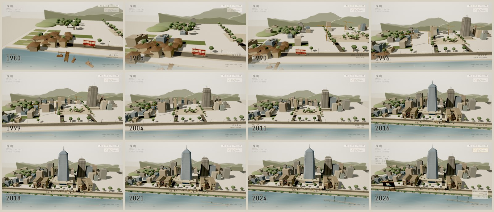](docs/screenshots/contact-sheet.png)

### 白天主视图与地标

| | |
| --- | --- |
| [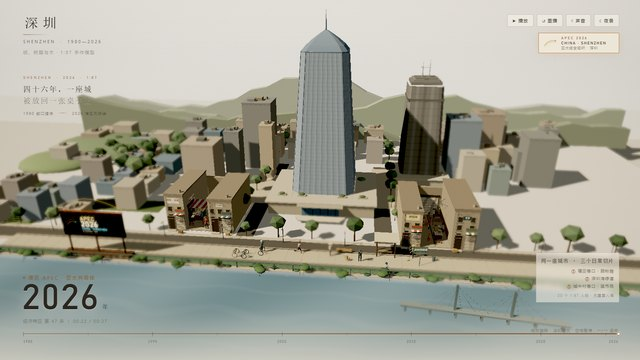](docs/screenshots/sz-2026.png) | [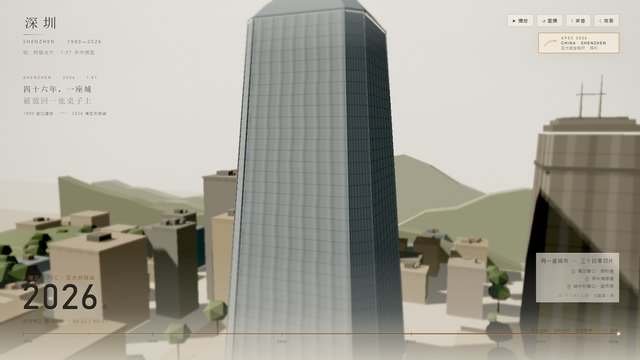](docs/screenshots/close-pingan.png) |
| 2026 湾区天际线 | 平安金融中心塔身/塔冠 |
| [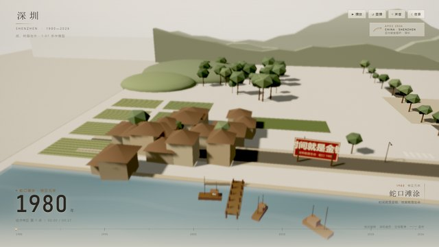](docs/screenshots/sz-1980.png) | [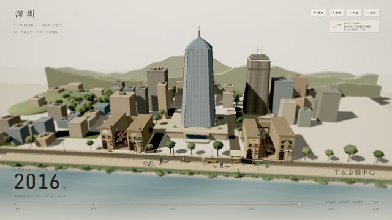](docs/screenshots/sz-2016.png) |
| 1980 蛇口滩涂、渔船与木栈桥 | 2016 平安封顶 |

### 三组生活切片

| | |
| --- | --- |
| [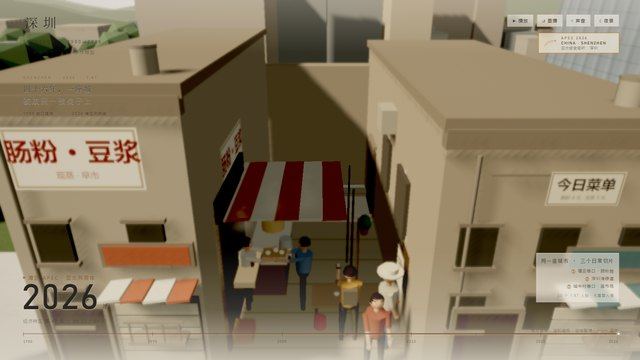](docs/screenshots/close-breakfast.png) | [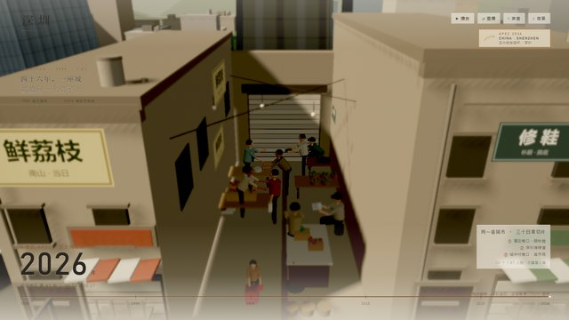](docs/screenshots/close-market.png) |
| 早餐肠粉摊 · 5 人 | 城中村菜市场 · 9 人 |
| [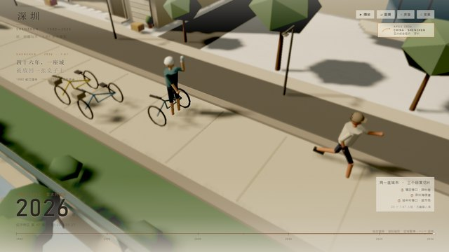](docs/screenshots/close-greenway-w.png) | [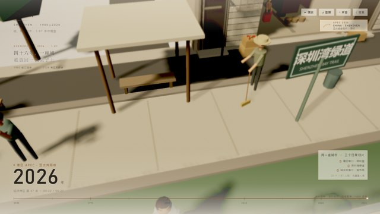](docs/screenshots/close-greenway-e.png) |
| 深圳湾绿道 · 骑行者/跑步者 | 深圳湾绿道 · 遛狗/拍照/看海 |

### 霓虹夜景

| | |
| --- | --- |
| [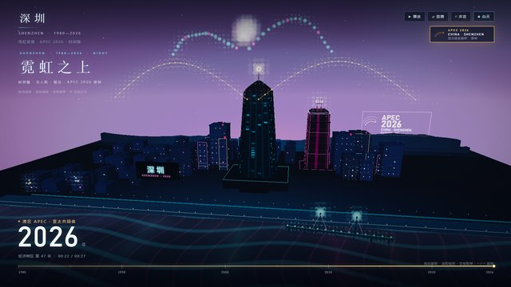](docs/screenshots/sz-night.png) | [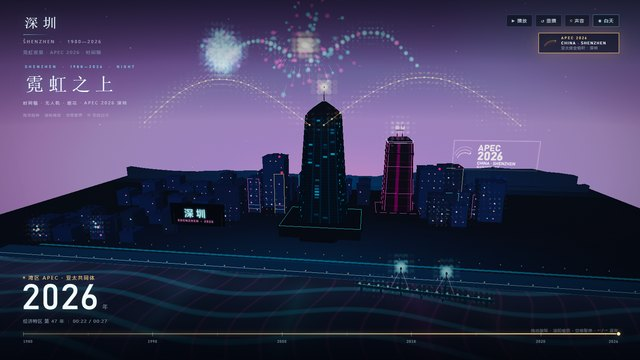](docs/screenshots/sz-night-2.png) |
| 2026 APEC：鹏翼、无人机与烟花 | 另一帧烟花/编队 |
| [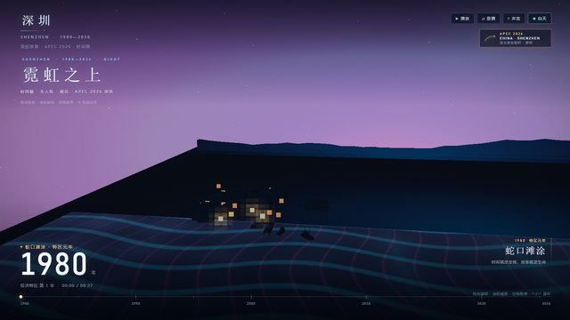](docs/screenshots/sz-night-1980.png) | [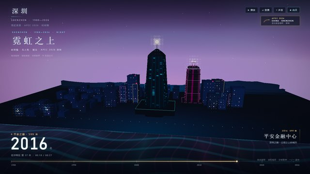](docs/screenshots/sz-night-2016.png) |
| 夜景时间轴 · 1980 渔村与零星灯火 | 夜景时间轴 · 2016 平安封顶 |

### 湾水与响应式

| | |
| --- | --- |
| [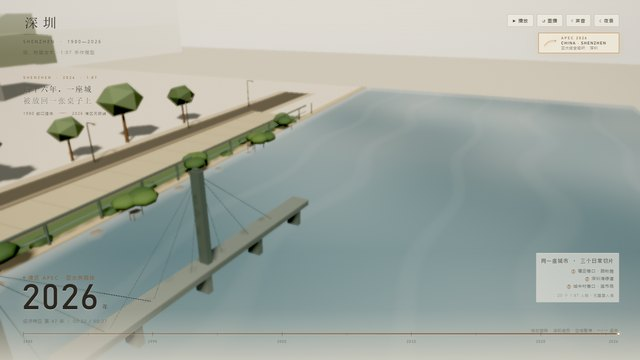](docs/screenshots/close-bay.png) | [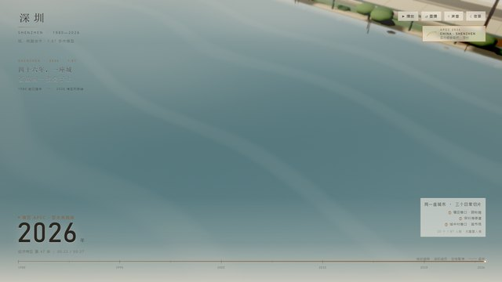](docs/screenshots/close-water.png) |
| 深圳湾水面 / 大桥 | 薄层亚克力水面近景 |
| [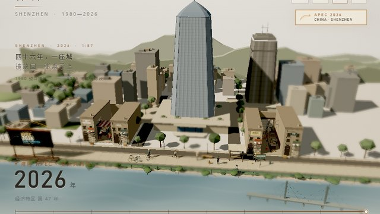](docs/screenshots/smoke-900.png) | [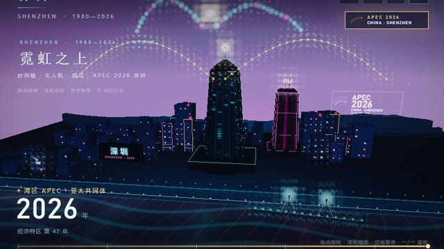](docs/screenshots/smoke-night-900.png) |
| 900×600 白天 | 900×600 夜景 |

---

## 设计说明与已知限制

- **有意识压缩**：地标间距、城市进深、山体高度和人物尺度不是统一测绘比例；1:87 人物与地标同台时优先可读性。
- **夜景也走完整时间轴**：早期用渔村/渔船/旧招牌与少量灯火表达 1980，地标和城市体量在对应年份出现；无人机、烟花和 APEC 标识在 2025 后进入。夜景的早期镜头会自动向西平移，2020 后回到湾区主视角。
- **无真人面孔**：人物以低多边形、衣着和姿态辨认，不做大头卡通。
- **不是真实航拍**：镜头是略俯视的微距模型视角，允许移轴虚化与摄影棚布光。
- **本地文件**：Chromium 系浏览器可直接打开；部分浏览器对 `file://` 资源有限制，建议使用 `npm run serve`。
- **截图脚本**：需要 Chromium；SwiftShader 下较慢，但不影响页面本身。

---

## 许可与致谢

- 项目代码与生成截图：[MIT License](LICENSE)
- Three.js r160：MIT，见 [vendor/LICENSE.three](vendor/LICENSE.three) 与 [vendor/README.md](vendor/README.md)
- 字体使用系统字体，不随项目分发。
- 深圳的城市记忆、地名与日常细节是这件作品的叙事来源；所有几何、材质与效果均为程序化生成。

---

## English summary

A single-file Three.js diorama of Shenzhen: a handmade paper/resin/basswood city
and a separate neon night scene, both sharing the same 1980—2026 timeline,
year display, play/pause, replay and scrubbing. Day and night have independent
scenes, cameras and post-processing and can be switched from the top-right
button or with `N` without losing the year or playback state. Both versions
carry an original APEC 2026 CHINA · SHENZHEN host mark: a persistent HUD badge,
a waterfront plaque in the day model, and a neon sign with golden wing bands at
night (plus a 48-drone formation and 760-particle fireworks). There are no
runtime dependencies, external assets or CDN requests; `index.html` is generated
from `src/` and `vendor/` and works offline. Node 22+ is only needed for the
optional build/screenshot scripts.
